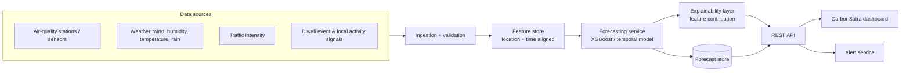

# CarbonSutra — Neighbourhood Pollution Digital Twin

> A decision-support concept that lets residents explore how air pollution could change across neighbourhoods and time — before exposure peaks.

## Round 1 submission

**Problem:** City-wide AQI averages hide meaningful street-to-street differences. During Diwali, fireworks, traffic, weather inversions, and local activity can push one neighbourhood into hazardous conditions while the city average appears manageable.

**Our solution:** CarbonSutra presents an interactive pollution digital twin: select a neighbourhood, move through the evening and next morning, and inspect AQI, sample pollutant proxies, peak time, potential drivers, and data-coverage state.

> **Demo integrity:** the current dashboard uses hand-authored synthetic fixtures. It does not use live observations, a trained model, or real confidence scores. The digital twin and forecasting pipeline are the proposed product direction.

### Working feature — Pollution Digital Twin

- **Interactive city map:** click Rohini, Saket, Dwarka or Noida to inspect a scenario.
- **Time slider:** explore the scenario from 6 PM through the following morning.
- **Neighbourhood details:** AQI, sample PM2.5/PM10 proxies and derived peak time update together.
- **Coverage state:** a visible, deliberately unrated coverage indicator avoids false certainty.

## MVP scope

| Feature | Round 1 | MVP (Round 2) |
| --- | --- | --- |
| Project architecture & product flow | ✅ | ✅ |
| Interactive forecast dashboard | ✅ mock data | ✅ live data |
| 72-hour AQI / PM2.5 forecast | UI demo | ML inference API |
| Weather, traffic, event feature fusion | designed | implemented |
| Locality map / hotspot layer | designed | implemented |
| Alerts and recommendations | UI demo | configurable notifications |

## Architecture



### Forecasting approach

1. Align hourly historical PM2.5, PM10, NO₂ and AQI readings with weather and traffic signals per locality.
2. Add lag features (1h, 6h, 24h), time features, Diwali proximity, and an event-intensity indicator.
3. Train a baseline tree-based regressor per pollutant; compare against a time-series baseline.
4. Predict the next 72 hours, calculate an AQI band, and expose confidence and top contributing factors.
5. Continuously compare forecasts with newly observed sensor values to monitor error and retrain.

**Evaluation:** MAE/RMSE for PM2.5 and AQI; accuracy/F1 for AQI health bands; special holdout testing on Diwali windows.

## Product flow

`Choose locality → inspect current air → view 72-hour forecast → understand key drivers → receive tailored action`

## Tech stack

- **Frontend:** HTML, CSS, vanilla JavaScript (rapid, dependency-free demo)
- **API (planned):** FastAPI / Python
- **ML (planned):** pandas, scikit-learn or XGBoost; MLflow for tracking
- **Storage (planned):** PostgreSQL + PostGIS / TimescaleDB
- **Data:** CPCB/OpenAQ-compatible air-quality readings, weather provider, traffic/event proxies

## Run the demo

The Round 1 dashboard has no dependencies.

```bash
cd /Users/evaan/Desktop/coding/carbonsutra
python3 -m http.server 8080
```

Open `http://localhost:8080` in a browser, or click **Go Live** in VS Code.

## Repository structure

```
.
├── index.html              # interactive Round 1 dashboard
├── styles.css              # visual system and responsive layout
├── app.js                  # deterministic demo forecast model + interactions
├── docs/
│   └── architecture.md     # implementation-ready system design
└── README.md               # project story and setup
```

## Team pitch (30 seconds)

“CarbonSutra moves air-quality awareness from a city-wide number to a neighbourhood decision. We fuse pollution history with weather, traffic, and Diwali activity to forecast where and when pollution will peak in the next 72 hours. Instead of only reporting danger after it happens, we explain the cause and give residents time to protect themselves.”

## Next build steps

1. Connect a real air-quality and weather source.
2. Implement the feature pipeline and baseline forecast API.
3. Add map-based locality selection and threshold-based alerts.
4. Train/evaluate on historical Diwali periods and display accuracy metrics.
